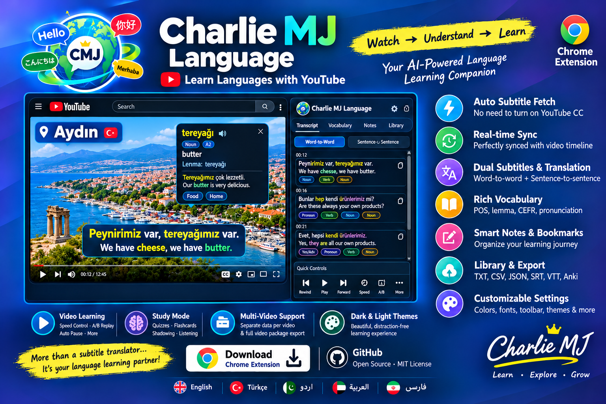
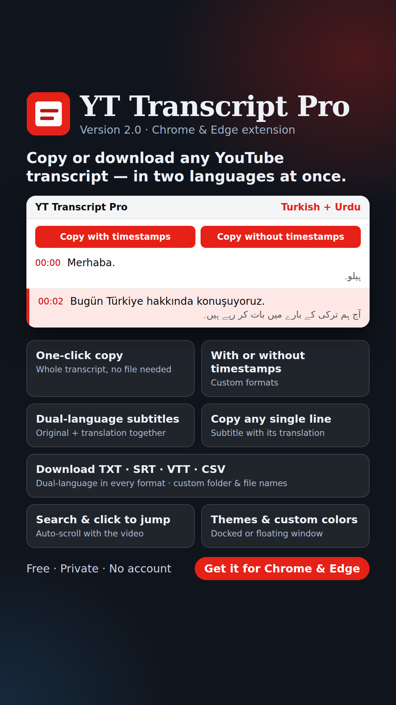

# Charlie MJ Language --- v1.0.0 Stable Beta

> A lightweight, local-first Chrome extension for learning languages
> through YouTube.



Charlie MJ Language turns YouTube into a practical language-learning
workspace while keeping the original fast transcript workflow as its
core engine. It adds transcript tools, Dual Transcript, subtitle
controls, vocabulary and sentence learning, automatic subtitle pausing,
audio replay, Favorites, Categories, Learning Groups, YouTube metadata
and thumbnails, Suggestions, and local data synchronization.

## Download

<p align="center">
  <a href="downloads/charliemj-language-v1.0.0-youtube-language-catalog-2026-10-20.zip">
    
  </a>
  &nbsp;
  <a href="downloads/YT-Transcript-Pro/YT-Transcript-Pro-v2.0.0.zip">
    
  </a>
  &nbsp;
  <a href="downloads/charlie-mj-dual-transcript-engine/charlie-mj-dual-transcript-engine-v1.0.0.zip">
    
  </a>
</p>


## Key Features

-   ⚡ **Quick Fetch Complete Transcript** --- quickly fetch the
    complete available YouTube caption track with timestamps.
-   🌐 **Dual Transcript** --- view original and YouTube-native
    translated subtitles/transcripts together.
-   ⏸️ **Auto Pause on Each Subtitle** --- pause playback at each
    subtitle/cue for reading and practice.
-   🔁 **Replay Audio** --- replay the current subtitle or sentence for
    listening and pronunciation practice.
-   🎯 **Click-to-Seek Transcript** --- click transcript rows to jump to
    the matching video timestamp.
-   🔄 **Live Transcript Synchronization** --- keep transcript position
    synchronized with playback.
-   🗣️ **Original + Translated Subtitles** --- control subtitle display,
    layout, typography, opacity, and translation.
-   🌍 **YouTube Language Catalog** --- use caption and translation
    language availability supplied by YouTube for the current video.
-   ❤️ **Favorite Channels** --- save channels using stable YouTube
    Channel IDs and fetch their details.
-   📚 **Favorite Playlists** --- save playlists using stable YouTube
    Playlist IDs and fetch their details.
-   🖼️ **YouTube Metadata & Thumbnails** --- retrieve available titles,
    descriptions, channel/playlist information, URLs, IDs, and
    thumbnails.
-   🏷️ **Categories** --- organize channels and playlists into
    searchable learning categories.
-   👥 **Learning Groups** --- organize saved resources into custom
    groups.
-   💡 **YouTube Suggestions** --- fetch Suggested Channels and
    Suggested Playlists and decide what to save.
-   🔎 **Search & Filtering** --- search channels, playlists,
    categories, suggestions, names, descriptions, tags, and categories.
-   📝 **Learning Library** --- save vocabulary, sentences, notes,
    bookmarks, and Watch Later records.
-   💾 **Import / Export** --- back up and restore structured local
    learning data.
-   🔄 **Data Sync** --- compare and synchronize local data with the
    configured GitHub repository when enabled.
-   ⚡ **Performance Controls** --- optional services remain on-demand
    instead of continuously running.
-   🎛️ **Custom Learning UI** --- configurable toolbar, transcript
    window, subtitles, and additional learning windows.

## Table of Contents

-   [Overview](#overview)
-   [Version and Platform](#version-and-platform)
-   [Critical Core Functionality](#critical-core-functionality)
-   [Performance and Lightweight
    Architecture](#performance-and-lightweight-architecture)
-   [Dual Transcript](#dual-transcript)
-   [Transcript Window](#transcript-window)
-   [Subtitles, Translation, and Language
    Selection](#subtitles-translation-and-language-selection)
-   [Automatic Subtitle Pause](#automatic-subtitle-pause)
-   [Audio Replay and Sentence
    Learning](#audio-replay-and-sentence-learning)
-   [Vocabulary and Sentence
    Learning](#vocabulary-and-sentence-learning)
-   [My Learning Library](#my-learning-library)
-   [Favorite Channels and Playlists](#favorite-channels-and-playlists)
-   [YouTube Metadata and Thumbnails](#youtube-metadata-and-thumbnails)
-   [Learning Groups](#learning-groups)
-   [Categories](#categories)
-   [Extension Intelligence](#extension-intelligence)
-   [YouTube Suggestions](#youtube-suggestions)
-   [Search and Filtering](#search-and-filtering)
-   [Data Sync](#data-sync)
-   [Import and Export](#import-and-export)
-   [Settings](#settings)
-   [UI and Window Controls](#ui-and-window-controls)
-   [Live Transcript Highlighting](#live-transcript-highlighting)
-   [Notifications and Save
    Reliability](#notifications-and-save-reliability)
-   [Privacy and Storage](#privacy-and-storage)
-   [Installation](#installation)
-   [Recommended First-Run
    Configuration](#recommended-first-run-configuration)
-   [Project Structure](#project-structure)
-   [Architecture Principles](#architecture-principles)
-   [Regression Testing](#regression-testing)
-   [Known Platform Considerations](#known-platform-considerations)
-   [Development Guidelines](#development-guidelines)
-   [License](#license)

## Overview

Charlie MJ Language brings together:

-   YouTube subtitles and complete timestamped transcripts
-   Fast automatic transcript fetching
-   Click-to-seek transcript timeline navigation
-   Transcript scrolling and synchronization with video playback
-   Original and translated subtitles
-   YouTube-native language and translation availability
-   Dual Transcript
-   Automatic pause on each subtitle/cue
-   Audio replay for the current subtitle/sentence
-   Vocabulary and sentence learning
-   Notes, bookmarks, and Watch Later
-   Favorite YouTube Channels and Playlists
-   Channel and playlist detail fetching from YouTube
-   YouTube metadata and thumbnail support
-   Learning Groups
-   Categories and category intelligence
-   YouTube Suggestions
-   Searchable Categories and Suggestions
-   Data import/export and synchronization tools
-   Performance and service-lifecycle controls
-   Customizable toolbar, transcript window, subtitles, and learning UI

The systems are designed to work independently. Basic transcript
functionality does not depend on Dual Transcript, metadata services,
Suggestions, Categories, or Data Sync.

## Version and Platform

-   **Version:** `1.0.0 Stable Beta`
-   **Platform:** Chrome Extension --- Manifest V3
-   **Minimum Chrome version:** 114
-   **License:** MIT
-   **Repository:** [GitHub
    repository](https://github.com/awsrmmustansarjavaid/charlie-mj-language)

## Critical Core Functionality

The original transcript system is the primary and authoritative
transcript engine.

The v1.0.0 Stable Beta release does **not** replace or rewrite the
original transcript-fetching implementation.

The default engine remains:

``` text
legacy-youtube
```

The core workflow is:

1.  Open a YouTube video.
2.  The extension detects the video.
3.  The original transcript engine fetches the available complete
    caption track.
4.  The complete timestamped transcript becomes available.
5.  The user can scroll through the transcript.
6.  Transcript rows remain associated with timestamps.
7.  Clicking a transcript row seeks the video to that timestamp.
8.  Playback and transcript position remain synchronized where
    supported.
9.  Existing subtitle, translation, vocabulary, sentence, notes, and
    learning workflows can use the transcript.

### Core preservation requirement

New services must never:

-   replace `legacy-youtube`
-   rewrite its fetching algorithm merely to support another service
-   delay the original transcript while waiting for an optional service
-   create a second YouTube player
-   continuously intercept YouTube traffic for basic transcript
    operation
-   remove transcript scrolling or timeline seeking
-   remove existing transcript-learning functionality

The original transcript remains the reference source for additional
transcript systems.

## Performance and Lightweight Architecture

v1.0.0 Stable Beta is designed so optional services do not make normal
YouTube playback unnecessarily heavy.

### Startup principle

The extension should load only what is required for normal operation:

-   core extension logic
-   existing transcript functionality
-   required settings
-   lightweight UI
-   small indexes/cache metadata

Optional services remain dormant until needed.

### Service lifecycle

Optional services follow an event-driven lifecycle:

``` text
IDLE
  ↓
ACTIVE
  ↓
INACTIVE
  ↓
SLEEPING
  ↓
WAKE
  ↓
ACTIVE
```

Enabled does not mean continuously running.

### Performance controls

Performance settings provide controls for:

-   lightweight startup
-   on-demand service activation
-   service sleep timeout
-   resource-intensive service enable/disable
-   lazy loading
-   caching
-   background-task controls
-   event-driven operation
-   reduced unnecessary polling
-   reduced unnecessary YouTube requests

The goal is for normal YouTube playback and the original transcript path
to remain the priority.

## Dual Transcript

Dual Transcript is an additional, independent transcript system. It does
not replace or delay the original transcript engine.

### Entry points

Dual Transcript can be opened from:

-   the Dual Transcript button in the YouTube learning toolbar
-   the Dual Transcript tab inside the Transcript window

### YouTube language catalog

Language choices are derived from YouTube caption information where
available rather than relying only on a fixed hard-coded language list.

The system can use:

-   available caption tracks
-   YouTube translation languages
-   original caption information
-   YouTube-native translation requests

This lets the user select languages that are actually available for the
current video.

### Fetching workflow

``` text
YouTube video
    ↓
YouTube caption information
    ↓
Available caption track
    ↓
YouTube-native translation when available
    ↓
Cue parsing and alignment
    ↓
Sentence merging
    ↓
Timeline synchronization
    ↓
Dual Transcript UI
```

### Features

-   Original subtitle/transcript
-   YouTube-native auto-translated subtitle/transcript
-   Original language selection
-   Target language selection
-   Complete timestamped cues
-   Cue alignment
-   Sentence merging
-   Timeline synchronization
-   Current-sentence tracking
-   Search
-   Refresh
-   Local caching
-   Translation availability status
-   Independent original/translated subtitle colors
-   Synchronized speaker/replay control
-   Save supported words to the learning library
-   Save supported sentences to the learning library

If YouTube does not provide a requested translation track, the original
transcript workflow remains available.

## Transcript Window

The Transcript window supports:

-   dragging
-   resizing
-   minimize
-   maximize
-   pin
-   close
-   restore
-   saved position
-   saved dimensions
-   viewport protection
-   scrolling
-   transcript tabs
-   synchronized playback

When minimized, a hover-based restore/maximize control can appear when
the mouse is moved near the minimized window.

## Subtitles, Translation, and Language Selection

The extension supports:

-   original subtitles
-   translated subtitles
-   YouTube-native translation
-   subtitle appearance controls
-   subtitle layout controls
-   width and height controls
-   maximum line controls
-   wrapping
-   padding
-   corner radius
-   opacity
-   typography
-   line spacing
-   translation display
-   timestamp synchronization

Native on-screen captions may be used as a fallback when timestamped
transcript information is unavailable.

### Language controls

Language selectors can reflect the caption and translation information
available from YouTube for the current video.

## Automatic Subtitle Pause

Automatic subtitle pause is an optional learning control that pauses
playback for each subtitle/cue.

Typical workflow:

``` text
Play video
   ↓
Subtitle appears
   ↓
Pause
   ↓
Read / listen / repeat
   ↓
Continue
   ↓
Next subtitle
   ↓
Pause again
```

The feature is integrated with the existing subtitle/timing workflow and
does not require a second player.

## Audio Replay and Sentence Learning

The learning interface provides replay controls for the current subtitle
or sentence.

Supported learning actions include:

-   replay current audio
-   replay a sentence
-   seek to the sentence timestamp
-   repeat listening
-   sentence looping where supported
-   A/B replay where supported
-   playback-speed learning controls

These tools are designed for listening comprehension, pronunciation
practice, and repeated exposure.

## Vocabulary and Sentence Learning

Learning tools include:

-   interactive word lookup
-   translation
-   dictionary information
-   provider/source information where available
-   part-of-speech information where available
-   vocabulary capture
-   sentence saving
-   timestamp-linked learning records
-   sentence replay
-   looping
-   playback-speed controls
-   notes
-   bookmarks
-   supported-word saving from transcript workflows
-   supported-sentence saving from transcript workflows

## My Learning Library

The local learning library supports:

-   vocabulary
-   saved sentences
-   bookmarks
-   notes
-   Watch Later
-   learning records
-   search
-   filtering
-   import/export
-   local-first storage

Existing learning data remains independent from optional metadata and
suggestion services.

## Favorite Channels and Playlists

### Favorite Channels

Save and manage YouTube channels using stable Channel IDs.

Channel workflows can include:

-   save channel
-   fetch channel details
-   refresh metadata
-   view/open channel
-   edit local information
-   remove from Favorites
-   assign category
-   assign Learning Group
-   search/filter saved channels

### Favorite Playlists

Save and manage YouTube playlists using stable Playlist IDs.

Playlist workflows can include:

-   save playlist
-   fetch playlist details
-   refresh metadata
-   view/open playlist
-   edit local information
-   remove from Favorites
-   assign category
-   assign Learning Group
-   search/filter saved playlists

### Stable identity

Duplicate detection uses stable YouTube IDs rather than display names.

Therefore:

-   the same ID is treated as the same resource
-   different IDs can have the same display name
-   names are not the primary identity

## YouTube Metadata and Thumbnails

The Favorites and learning-library systems can obtain available YouTube
metadata and thumbnails.

Metadata can include:

-   title
-   description
-   channel information
-   playlist information
-   thumbnail
-   stable YouTube ID
-   source URL
-   type/source information

Refresh operations should not overwrite user-owned:

-   notes
-   tags
-   categories
-   learning data

Metadata refresh should be rate-limited, cached, and performed only when
needed.

## Learning Groups

Learning Groups provide another level of organization for saved YouTube
resources.

They support:

-   View
-   Edit
-   Remove
-   resource management
-   category association
-   channel organization
-   playlist organization
-   learning organization

## Categories

Categories organize channels, playlists, and learning resources.

Category cards can show:

-   category name
-   description
-   resource count
-   channel count
-   playlist count
-   View
-   Open
-   Edit
-   Remove

### Category search

Categories are searchable from the main search field.

The displayed result count follows the active search:

``` text
20 categories
↓
Search: music
↓
4 categories
```

The category list and result count are based on the same filtered result
set.

### Category detail

A category detail view provides access to channels and playlists
assigned to that category, with resource-level actions.

## Extension Intelligence

Extension Intelligence provides optional category assistance without
requiring an external AI service.

Capabilities include:

-   master enable/disable
-   automatic category detection
-   existing-category suggestions
-   new-category suggestions
-   minimum confidence
-   prefer existing categories
-   automatic application of high-confidence suggestions
-   confirmation before creating categories
-   learning from accepted suggestions
-   learning from rejected suggestions

Potential information sources include:

-   YouTube metadata
-   title
-   description
-   tags/keywords
-   existing local categories
-   category knowledge data

### Important rule

The extension must not silently create a new category when a suggestion
has not been confirmed by the user.

## Category Knowledge

The category knowledge directory is organized separately from the
extension UI:

``` text
data/
└── category-knowledge/
    ├── youtube-categories.json
    ├── learning-categories.json
    ├── category-keywords.json
    └── category-rules.json
```

Official YouTube categories remain distinct from extension-specific
learning categories.

## YouTube Suggestions

The Suggestions workspace separates recommendations from Favorites.

It supports:

-   Suggested Channels
-   Suggested Playlists

Each result clearly identifies its type:

``` text
CHANNEL
PLAYLIST
```

Supported actions include:

-   View
-   Open
-   Save to Favorites
-   Add Category
-   Add Learning Group
-   Ignore

Suggestions are not automatically treated as Favorites.

### Suggestions search

The Suggestions workspace has a dedicated query used to fetch YouTube
recommendations.

The main search workflow can also filter displayed suggestion results
where supported, while the dedicated suggestion query remains available
for fetching new recommendations.

## Search and Filtering

Search and filtering can be used across:

-   channels
-   playlists
-   categories
-   suggestions
-   names
-   descriptions
-   tags
-   categories

Category search updates both visible cards and the result count.

Suggestions keep their dedicated fetch query while allowing displayed
results to be filtered where supported.

## Data Sync

The Data Sync workspace provides one clear area for maintaining local
data and optional GitHub-backed backups/synchronization.

Supported actions include:

-   local database status
-   GitHub database status
-   total local record count
-   total GitHub record count
-   per-resource counts for channels, playlists, and categories
-   Choose Local Folder
-   Validate Local
-   Health Check
-   Compare Local ↔ GitHub
-   Pull from GitHub
-   Prepare ZIP Backup
-   scheduled synchronization
-   separate JSON data files
-   indexes for fast lookup

### Default GitHub Repository

``` text
https://github.com/awsrmmustansarjavaid/charlie-mj-language
```

The repository URL remains editable by the user.

### Compare Local ↔ GitHub

The comparison result should clearly separate:

-   Local totals
-   GitHub totals
-   matching records
-   local-only records
-   GitHub-only records
-   changed/different records
-   database directories/files involved
-   recommended next action

### ZIP backup

Prepare ZIP Backup creates one downloadable ZIP archive containing
structured database JSON files and indexes.

Stable IDs remain the primary identity:

``` text
Channel ID
Playlist ID
```

### Browser limitation

A normal Chrome extension cannot silently write to arbitrary local
filesystem paths.

Supported approaches require an appropriate browser permission/API such
as:

-   user-selected File System Access locations
-   a Native Messaging helper
-   browser download/import flows
-   GitHub API/repository synchronization

The extension must not claim unrestricted access to arbitrary folders.

## Import and Export

JSON is the primary structured backup format.

Export can include:

-   saved channels
-   saved playlists
-   categories
-   Learning Groups
-   notes
-   tags
-   metadata
-   stable IDs

Import supports:

-   JSON validation
-   duplicate detection
-   merge
-   replace where explicitly selected
-   preservation of existing records during merge
-   invalid/skipped-record reporting
-   backup restoration

TXT exports can provide a readable list containing:

-   channel/playlist name
-   URL
-   category
-   tags
-   notes
-   date added

## Settings

Important settings areas include:

-   UI Components
-   Subtitle and Timeline
-   Appearance
-   Service Engine
-   Favorites
-   Categories
-   Extension Intelligence
-   Data Sync
-   YouTube Suggestions
-   Performance
-   Additional Learning Window

Settings should remain backward-compatible with existing stored values.

## UI and Window Controls

### Learning toolbar

The YouTube learning toolbar supports configurable:

-   position
-   size
-   scale
-   button arrangement
-   hover/reveal behavior
-   visibility
-   auto-hide behavior

### Transcript window

The Transcript window supports:

-   dragging
-   resizing width
-   resizing height
-   corner resizing
-   minimize
-   maximize
-   pin
-   close
-   restore
-   saved position
-   saved dimensions
-   viewport protection
-   scrolling
-   transcript tabs
-   synchronized playback

### Additional Learning window

The Additional Learning window follows the same window-management model:

-   resize width
-   resize height
-   minimize
-   maximize
-   pin
-   close
-   restore
-   remember position
-   remember size

## Live Transcript Highlighting

Live Transcript Highlighting synchronizes the active transcript row with
playback.

Features include:

-   enable/disable
-   transparent highlight
-   rounded background
-   underline
-   left accent
-   text-color highlighting
-   custom highlight color
-   background opacity
-   active text color
-   speaker indicator
-   playback synchronization
-   subtitle synchronization
-   optional automatic transcript scrolling
-   center/top/bottom auto-scroll positioning
-   manual-scroll protection
-   transition-duration control
-   preview
-   reset

The feature operates on existing timestamped transcript segments and
does not replace the transcript-fetching engine.

## Notifications and Save Reliability

Save operations should report success only after the underlying storage
operation succeeds.

This applies to:

-   Watch Later
-   bookmarks
-   notes
-   vocabulary
-   sentences
-   library records
-   settings
-   Favorites
-   Categories
-   Learning Groups

If Chrome invalidates an extension content-script context after an
extension reload/update, storage-dependent operations should fail safely
and request a page refresh rather than falsely reporting success.

## Privacy and Storage

Charlie MJ Language is local-first.

Local settings and learning records are stored using Chrome extension
storage and/or appropriate local extension storage mechanisms.

Some optional features may contact external services when the user
requests them, such as:

-   YouTube services/endpoints
-   YouTube caption/translation services
-   GitHub synchronization

External service use should occur only for the relevant feature and
should not be required for basic transcript functionality.

## Installation

1.  Download or clone this repository.
2.  Extract the ZIP if necessary.
3.  Open Chrome.
4.  Visit:

``` text
chrome://extensions/
```

5.  Enable **Developer mode**.
6.  Click **Load unpacked**.
7.  Select the extension directory containing `manifest.json`.
8.  Open or refresh a YouTube video.

If YouTube was already open when the extension was installed or
reloaded, refresh the YouTube tab once.

## Recommended First-Run Configuration

For the lightest normal YouTube experience:

1.  Keep the original `legacy-youtube` transcript engine enabled.
2.  Keep the original transcript workflow as the default.
3.  Leave Dual Transcript inactive until needed.
4.  Enable automatic subtitle pause only when you want
    subtitle-by-subtitle practice.
5.  Use Replay Audio when practicing listening or pronunciation.
6.  Enable metadata refresh only when needed.
7.  Use category intelligence only if automatic category assistance is
    desired.
8.  Configure Data Sync separately from normal transcript operation.

This keeps the critical path focused on:

``` text
YouTube
  ↓
Original Transcript Engine
  ↓
Complete Transcript
  ↓
Scroll / Timeline / Learning
```

## Project Structure

``` text
charlie-mj-language/

│
├── assets/
├── data/
│   └── category-knowledge/
│       ├── youtube-categories.json
│       ├── learning-categories.json
│       ├── category-keywords.json
│       └── category-rules.json
│
├── docs/
├── icons/
│
├── src/
│   ├── background/
│   ├── content/
│   │   ├── youtube.js
│   │   └── youtube-page-bridge.js
│   ├── dashboard/
│   ├── dual-transcript/
│   ├── favorites/
│   ├── lib/
│   ├── options/
│   └── popup/
│
├── transcript-service.config.json
├── manifest.json
├── LICENSE
└── README.md
```

The exact source tree may evolve as independent services are added. The
important architectural rule is that the original transcript
implementation remains isolated and authoritative.

## Architecture Principles

### Strict additive-only development rule

Existing working systems and features are treated as **untouchable
unless the user explicitly requests a change**.

When adding functionality:

-   add new code as an independent subsystem where practical
-   do not remove an existing feature to make room for a new feature
-   do not replace a working implementation simply because a new
    implementation is available
-   do not change unrelated existing behavior
-   keep existing settings and storage compatible
-   test the original feature before and after every new integration
-   treat a regression in an existing working feature as a release
    blocker

### Core principles

1.  **Preserve the core** --- the original fast complete-transcript
    engine is not replaced.
2.  **Add, don't remove** --- new functionality is additive.
3.  **Independent services** --- Dual Transcript, Favorites, Categories,
    Data Sync, Suggestions, Intelligence, and other services operate
    independently.
4.  **No unnecessary continuous work** --- optional services should
    sleep when inactive.
5.  **Event-driven operation** --- prefer events and explicit user
    actions over aggressive polling.
6.  **Stable identities** --- use YouTube Channel IDs and Playlist IDs
    instead of names as primary identifiers.
7.  **Safe storage** --- do not silently erase existing user data.
8.  **Backward compatibility** --- existing settings, storage,
    transcript workflows, and learning records should remain usable.
9.  **No second YouTube player** --- additional transcript services must
    not recreate the YouTube player.
10. **Original transcript remains authoritative** --- additional
    transcript sources are compared against the original rather than
    replacing it.

## Regression Testing

Before releasing a build, verify at minimum:

### Core transcript

-   YouTube video loads normally.
-   YouTube playback starts without extension-induced buffering.
-   Original transcript automatically appears.
-   Complete transcript is fetched.
-   Transcript can scroll to the end.
-   Transcript timestamps remain available.
-   Clicking a transcript row seeks the video.
-   Playback and transcript remain synchronized.
-   Original subtitles still work.
-   Translation still works.

### Automatic subtitle pause

-   Auto pause can be enabled and disabled.
-   Playback pauses at subtitle/cue boundaries.
-   Playback continues correctly after the pause.
-   Existing transcript timing remains correct.
-   Disabling auto pause restores normal playback.

### Audio replay

-   Current subtitle/sentence can be replayed.
-   Replay seeks to the correct timestamp.
-   Replay does not create a second player.
-   Replay does not interfere with transcript synchronization.

### Dual Transcript

-   Original transcript remains available.
-   Original and target language selectors load available YouTube
    languages.
-   YouTube-native translation is used when available.
-   Cue alignment remains synchronized.
-   Missing translation does not break the original transcript.

### Library

-   Channels can be saved.
-   Playlists can be saved.
-   Channel details can be fetched/refreshed.
-   Playlist details can be fetched/refreshed.
-   Thumbnails can be displayed/refreshed.
-   Stable IDs prevent duplicate records.
-   Same-name resources with different IDs remain separate.
-   Categories can be assigned.
-   Learning Groups support view/edit/remove.
-   Metadata refresh does not overwrite user data.

### Categories

-   Categories can be searched.
-   Result count matches filtered results.
-   Clearing the search restores the total count.
-   View/Open/Edit/Remove actions continue to work.

### Suggestions

-   Suggested Channels can be fetched.
-   Suggested Playlists can be fetched.
-   Suggestion type is visible.
-   Suggestion query remains functional.
-   Results can be searched/filtered where supported.
-   Save/Add Category/Add Learning Group actions work.

### Performance

-   Extension startup remains lightweight.
-   YouTube playback remains responsive.
-   Optional services remain idle until required.
-   No unnecessary continuous network traffic is generated.
-   Service sleep/wake behavior works as configured.

### Settings

-   Existing settings remain available.
-   New settings appear in their intended sections/tabs.
-   Settings persist after Chrome restart.
-   Grid layout remains usable at different widths.

## Known Platform Considerations

YouTube can change its player, caption endpoints, page structure, and
internal APIs without notice.

Caption availability varies by video and may depend on:

-   available language tracks
-   manual captions
-   auto-generated captions
-   auto-translation availability
-   YouTube changes
-   video-owner settings

Therefore, no extension can guarantee a particular caption language for
every YouTube video.

Live Chrome/YouTube regression testing should be performed before
distributing a production build.

---

# Charlie MJ Dual Transcript Engine

A standalone, lightweight Chrome/Chromium extension whose only core job is to obtain a **complete original + YouTube-native translated transcript** from YouTube as quickly as possible, cache it locally, and keep both tracks synchronized with `video.currentTime`.

## Download

<p align="center">
  <a href="downloads/charlie-mj-dual-transcript-engine/charlie-mj-dual-transcript-engine-v1.0.0.zip">
    
  </a>
  &nbsp;
  <a href="Chrome%20Different%20Extentions/charlie-mj-dual-transcript-engine/README.md">
    
  </a>
</p>

---

# YT Transcript Pro

Copy or download YouTube transcripts and two-language (dual) subtitles, with or without timestamps. Manifest V3, Chrome and Edge, no account, no server, no analytics.



## Download

<p align="center">
  <a href="downloads/YT-Transcript-Pro/YT-Transcript-Pro-v1.0.0.zip">
    
  </a>
  &nbsp;
  <a href="downloads/YT-Transcript-Pro/YT-Transcript-Pro-v2.0.0.zip">
    
  </a>
  &nbsp;
  <a href="/Chrome Different Extentions/YT-Transcript-Pro/YT-Transcript-Pro-v2.0.0/YT-Transcript-Pro/README.md">
    
  </a>
</p>


---


## Development Guidelines

When modifying this project:

-   Do not rewrite the original transcript-fetching engine to add a new
    feature.
-   Do not remove existing settings to make room for new settings.
-   Do not create a second YouTube player.
-   Do not introduce continuous high-frequency YouTube polling.
-   Do not overwrite user notes, tags, categories, or learning data
    during metadata refresh.
-   Do not silently erase existing records during import.
-   Preserve stable IDs.
-   Keep optional services lazy-loaded/on-demand.
-   Keep YouTube metadata requests cached and rate-limited.
-   Validate JavaScript and JSON before packaging.
-   Test the extension on real YouTube videos before release.

## License

This project is distributed under the MIT License.

See [`LICENSE`](LICENSE) for details.
